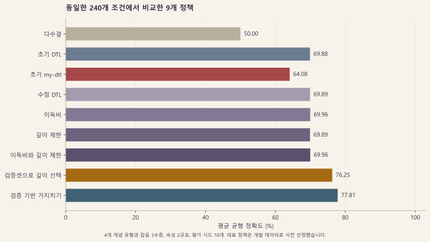
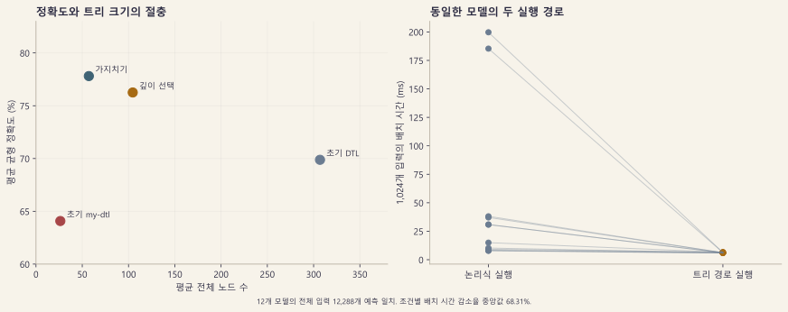
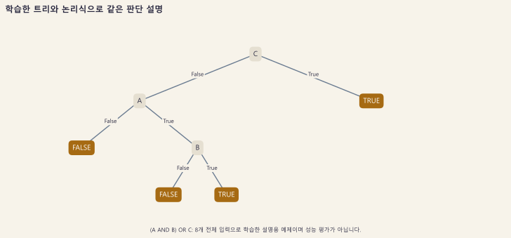
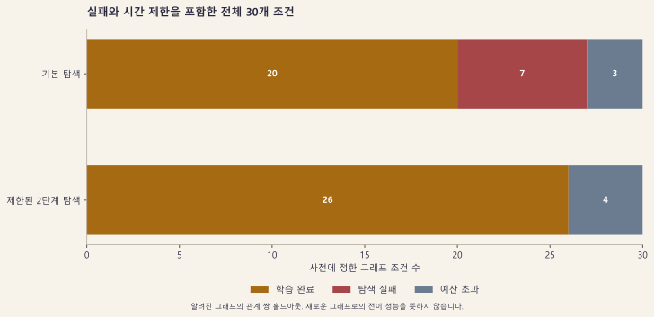

# 개선 실험 결과

[English](results.md) | [한국어](results.ko.md) | [프로젝트 README](../README.ko.md)

## 실험을 읽는 방법

속성 실험은 생성한 예제에서 참 또는 거짓을 판단하는 규칙을 학습합니다. **학습 데이터**로 트리를 만들고 **검증 데이터**로 설정을 고르며, **홀드아웃**은 그 학습에서 제외한 예제입니다. 개발 홀드아웃에서 대표 정책을 정한 뒤 별개의 최종 평가 조건으로 고정한 선택을 측정합니다. **난수 시드**는 무작위 생성과 분할을 재현하는 시작값이며, 여러 시드는 생성된 조건에 따라 결과가 얼마나 달라지는지 살펴보는 데 사용합니다.

**정확도**는 전체 평가 예제 중 정답을 맞힌 비율입니다. **균형 정확도**는 실제 양성과 음성을 각각 올바르게 찾은 비율을 평균해 두 종류의 정답에 같은 비중을 줍니다. **퍼센트포인트**는 백분율 점수 사이의 차이입니다. 노드 수는 트리의 복잡도를 보여주며 학습 시간과 설정 선택 시간은 서로 다른 계산 비용입니다. 어느 한 열만으로 이 차이를 모두 판단할 수는 없습니다.

## 결과와 적용 범위

최종 평가 전에 선택한 대표 정책 <strong>`gain-depth-tuned`의 평균 평가 균형 정확도는 76.25%</strong>입니다. 같은 240개 조건에서 초기 `my-dtl`의 **64.08%보다 12.17%p 상승**했으며 초기 정보 이득 학습기 `dtl`은 69.88%였습니다.

최종 균형 정확도가 가장 높은 조건은 <strong>77.81%인 `pruned-dtl`</strong>입니다. 이 구현도 사용할 수 있으며 모든 결과를 남겼습니다. 최종 평가 결과를 확인한 뒤 대표를 바꾸지는 않았습니다. 평가 점수가 가장 높은 조건을 다시 선택하면 그 평가셋도 모델 선택에 사용한 데이터가 되기 때문입니다.

독립적인 무작위 정답을 음성 대조군으로 포함한 통제 합성 실험입니다. 외부 표 데이터나 실무 데이터에서의 정확도를 입증하지는 않습니다. 변경하지 않은 [초기 실험 보고서](experiment-report.ko.md)는 절차가 다르므로 별도로 해석합니다.

## 실험 절차

- 개발 단계는 시드 0~4와 속성 8개, 학습 정답 잡음 0% 및 30%, 네 가지 개념 유형의 **40개 조건**입니다.
- 최종 평가는 이전에 사용하지 않은 시드 100~109와 속성 8개 및 10개, 잡음 0%와 15% 및 30%를 조합한 **240개 조건**입니다.
- 개념 유형은 논리곱, 희소 논리곱을 연결한 논리합, 변수 세 개의 XOR와 균형을 맞춘 무작위 정답입니다. 무작위 정답은 공통 규칙이 없는 음성 대조군입니다.
- 클래스별로 나누어 학습 60%와 내부 검증 20%를 배정하고 나머지를 홀드아웃으로 남깁니다. 정수 단위의 실제 예제 수는 조건별로 기록합니다.
- 같은 조건의 모든 학습기에 동일한 개념과 분할, 학습 정답의 잡음 위치를 적용합니다. 검증과 홀드아웃 정답에는 잡음을 넣지 않습니다.
- 내부 검증은 깊이 2와 4, 6 및 속성 수 중에서 선택하며, 동률이면 노드 수와 실제 깊이가 작은 트리를 고릅니다. 검증 기반 가지치기도 내부 검증만 사용합니다.
- 외부 개발 홀드아웃으로 대표 정책을 고른 뒤 [`configs/adoption.json`](../configs/adoption.json)에 선택과 소스 해시를 고정하고 최종 평가를 실행했습니다.
- 아홉 조건에 걸친 **모델 평가 2,160회가 실패 없이 완료**됐습니다.

균형 정확도는 `(양성 재현율 + 음성 재현율) / 2`입니다. 클래스가 불균형해도 다수 클래스만 예측하면 50%가 됩니다. 표의 정확도는 고정한 240개 조건을 같은 비중으로 평균했으며 하나의 데이터셋에서 모든 예측을 합산한 정확도가 아닙니다.

## 아홉 조건 전체 비교



| 조건 | 평가 균형 정확도 | 평가 정확도 | 평균 노드 수 | 학습 중앙값 (ms) | 깊이 탐색 평균 (ms) |
| --- | ---: | ---: | ---: | ---: | ---: |
| 다수 클래스 기준 | 50.00% | 63.39% | 1.00 | — | — |
| 초기 `dtl` | 69.88% | 69.99% | 306.90 | 1.7880 | 0.0000 |
| 초기 `my-dtl` | 64.08% | 68.19% | 26.31 | 1.0639 | 0.0000 |
| `corrected-dtl` | 69.89% | 70.00% | 306.86 | 2.5890 | 0.0000 |
| `gain-ratio` | 69.96% | 70.08% | 307.18 | 2.6833 | 0.0000 |
| `depth-limited` | 69.89% | 70.00% | 270.13 | 2.7792 | 0.0000 |
| `gain-depth` | 69.96% | 70.08% | 270.13 | 2.8472 | 0.0000 |
| **`gain-depth-tuned` 사전 대표** | **76.25%** | **76.08%** | **104.56** | **2.6235** | **17.8389** |
| `pruned-dtl` | 77.81% | 78.22% | 57.12 | 4.0584 | 0.0000 |

학습 시간은 조건 안에서 세 번 학습한 중앙값을 구한 뒤 조건 전체의 중앙값으로 요약합니다. 깊이 선택 비용은 별도 평균으로 공개합니다. `pruned-dtl`의 가지치기는 학습 시간에 포함하며 비용이 없는 최적화로 취급하지 않습니다. 다수 클래스 기준은 시간을 측정하지 않아 대시로 표시했습니다.

대표 정책의 평균 노드 수는 초기 `dtl`보다 **65.93% 적은 104.56개**입니다. 초기 `my-dtl`의 26.31개보다는 커졌으므로 초기 변형의 극단적인 소형화와 학습 속도 일부를 포기하고 홀드아웃 균형 정확도를 높인 결과입니다. 새 모델이 두 초기 학습기보다 모두 빠르게 학습한다고 설명하지 않습니다.



대표 정책과 초기 `my-dtl`의 차이는 **12.17%p**, 시드별 평균 차이 열 개로 계산한 **Student-t 95% 구간은 10.27~14.08%p**입니다. 한 시드 안의 예측 수천 개를 서로 독립적인 실험으로 취급하지 않았습니다. 이 구간은 정한 합성 비교의 불확실성을 설명하며 외부 데이터에서의 개선을 보장하지 않습니다.

## 개념 유형별 대표 결과

**논리곱**은 나열한 조건이 모두 참이어야 하고, **희소 논리식**은 소수의 AND 조건 묶음 중 하나라도 만족하면 참이 됩니다. **XOR**는 관련 불리언 입력 중 참인 값의 수가 홀수일 때 참입니다. **무작위 정답 대조군**은 서로 관련 없는 정답을 부여해, 학습할 구조가 없는 경우에도 평가가 그 한계를 드러내는지 확인합니다.

| 유형 | 초기 `my-dtl` 균형 정확도 | 대표 정책 균형 정확도 |
| --- | ---: | ---: |
| 논리곱 | 76.61% | 95.08% |
| 희소 논리식 | 79.42% | 91.01% |
| XOR | 50.70% | 68.74% |
| 무작위 정답 대조군 | 49.59% | 50.20% |

무작위 정답의 결과가 우연 수준에 가까운 것은 예상한 동작입니다. 불리언 특성만으로 독립적인 미관측 무작위 정답을 알아낼 수는 없습니다. XOR도 희소한 구조를 가진 두 유형보다 어렵게 남았습니다. 전체 평균의 개선과 함께 이 한계도 공개합니다.

## 예측 실행 방식의 개선

학습한 논리합은 설명용으로 유지하고, 실제 예측은 모든 양성 논리곱을 순회하는 대신 보관한 트리를 따라가도록 개선했습니다.



영어와 한국어 규칙 그림은 같은 저장된 설명용 트리를 사용합니다. 모델을 다시 학습하거나 벤치마크 기록을 바꾸지 않고 한국어 문구만 갱신하려면 이 프로젝트 폴더에서 `python tools/generate_figures.py --language ko --only-rules`를 실행합니다. 저장 모델과 출력 파일의 해시는 `figures/rules-localization.json`에 기록합니다.

그림은 불리언 입력 여덟 개 전체로 학습한 설명용 `(A AND B) OR C` 예제이며 별도의 홀드아웃 성능 결과가 아닙니다.

별도 최종 추론 실험은 **학습 모델 12개**에서 각각 **불리언 입력 전체 1,024개**를 확인해 **예측 12,288개가 트리와 논리식에서 모두 같음**을 검증했습니다. 조건마다 실행 순서를 교대하고 한 번 준비한 뒤 경로별로 일곱 번 측정했습니다. <strong>조건별 배치 시간 감소율의 중앙값은 68.31%</strong>였습니다.

같은 가설과 유효한 완전 불리언 입력에 대한 CPU 배치 예측입니다. 학습 시간 단축이나 정확도 변화와는 구분합니다. 조건별 수치와 원시 시간은 [`reports/inference-evaluation.json`](../reports/inference-evaluation.json)에 남겼습니다.

## 근거와 실험 중단 기준

- [고정한 비교 계획](../configs/benchmark-plan.json)
- [최종 평가 전 선택 기록](../configs/adoption.json)
- [개발 조건과 예측](../reports/attribute-development.json)
- [최종 조건, 예측, 규칙과 측정 시간](../reports/attribute-evaluation.json)
- [개발 단계 추론 비교](../reports/inference-development.json)
- [최종 추론 비교](../reports/inference-evaluation.json)

명시한 깊이 후보와 검증 가지치기, 예측이 같은 트리 실행 실험을 마친 뒤 후보 탐색을 중단했습니다. 대표보다 점수가 낮은 조건도 비교 결과와 지원 구현으로 남깁니다. 초기 소스 스냅샷과 과거 표는 덮어쓰지 않았습니다.

## FOIL의 유한 그래프 관계 완성

여기서는 알려진 그래프의 연결을 이용해 한 노드에서 다른 노드로 도달할 수 있는 관계를 학습합니다. **탐욕 탐색**은 조건 하나를 추가했을 때 바로 좋아지는 후보를 고릅니다. **두 단계 탐색**은 한 조건으로 개선되지 않을 때 두 조건을 묶은 효과도 살펴봅니다. **완료**는 정해진 한도 안에서 학습을 끝냈다는 뜻이며 모든 예측이 맞았다는 뜻은 아닙니다. 따라서 표는 완료 여부와 전체 정답 조건, 실패를 나누고, 그 뒤에 완료된 조건만의 정확도를 제시합니다.

기본 탐욕 탐색은 유지합니다. 선택 옵션 `lookahead=2`는 한 조건만 추가했을 때 이득이 없어 멈추는 경우를 보완합니다. 양성 바인딩을 유지하는 이득 0의 첫 조건과 두 번째 조건을 결합해 양의 이득을 얻을 수 있을 때 제한적으로 채택합니다. 양의 이득을 가진 한 조건이 있으면 원래의 탐욕 선택을 사용합니다. 제한 없는 규칙 탐색으로 바꾸지는 않았습니다.

두 비교 모드에는 수명 관리와 오류 처리 및 예산 수정을 공통 적용했습니다. 완료 20개에서 26개로의 변화는 단일 조건과 두 조건 탐색 정책의 비교이며, 초기 `aa947038`의 FOIL 코드를 그대로 재실행한 직접 비교가 아닙니다.

확장은 별도 개발 조건에서 검토하고 최종 비교는 시드 200~202와 그래프 유형 다섯 개, 노드 수 8개 및 16개를 고정한 **모드별 30개 조건**으로 수행했습니다. 그래프는 선형 연결과 분리된 순환, 단절된 선형 연결, 조밀한 비순환 연결 및 자기 연결입니다. 모든 노드에 자기 연결을 명시하며 Prolog와 독립적인 Python 큐 기반 너비 우선 탐색으로 정답을 만듭니다.

| 사전에 정한 30개 조건의 결과 | 기본 탐욕 탐색 | 선택 가능한 두 단계 탐색 |
| --- | ---: | ---: |
| 학습 완료 | 20/30개 (66.67%) | 26/30개 (86.67%) |
| 홀드아웃 관계가 전부 정답인 조건 | 19/30개 | 25/30개 |
| 탐색 실패 | 7개 | 0개 |
| 탐색 예산 초과 | 3개 | 4개 |



완료율은 **20.00%p 상승**했으며 기본 탐색이 학습하지 못한 순환 조건 여섯 개를 복구했습니다. 두 모드 모두 완료한 스무 조건은 예측이 같았습니다. 탐색을 확대해도 자원 제한이 사라지는 것은 아니며 최종 조건 네 개는 정해 둔 예산을 초과했습니다.

두 단계 탐색이 **완료한 26개 조건**의 홀드아웃 관계는 <strong>1,566개 중 1,563개 정답으로 99.81%</strong>였습니다. 거짓 양성은 0개, 거짓 음성은 3개이며 정밀도 100%, 재현율 99.44%, F1 99.72%입니다. 미완료 네 조건을 제외한 조건부 지표이며 계획 전체의 정확도나 성공률이 아닙니다. 전체 분모를 유지한 완료율과 전부 정답인 조건 수도 함께 봅니다.

학습 중에도 배경 연결 사실을 제공하므로 알고 있는 그래프에서 남겨 둔 관계 쌍을 완성하는 평가입니다. 새로운 그래프로의 전이를 측정하지 않습니다. Prolog 질의 수는 Python에서 Prolog로 전달한 호출 수이며 내부 증명 단계 수가 아닙니다.

```bash
python tools/benchmark_foil.py --seed-start 200 --output outputs/foil-final-greedy.json
python tools/benchmark_foil.py --lookahead 2 --seed-start 200 --output outputs/foil-final-lookahead.json
```

[기본 탐색 개발 보고서](../reports/foil-development-greedy.json), [두 단계 개발 보고서](../reports/foil-development-lookahead.json), [최종 기본 탐색](../reports/foil-final-greedy.json)과 [최종 두 단계 탐색](../reports/foil-final-lookahead.json)에 실패를 포함한 모든 조건을 남겼습니다.
