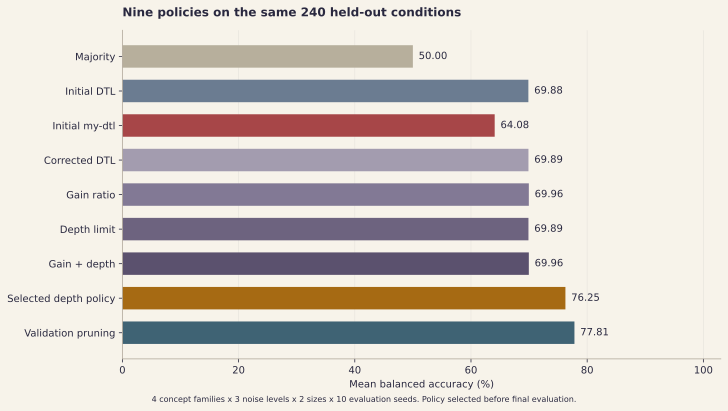
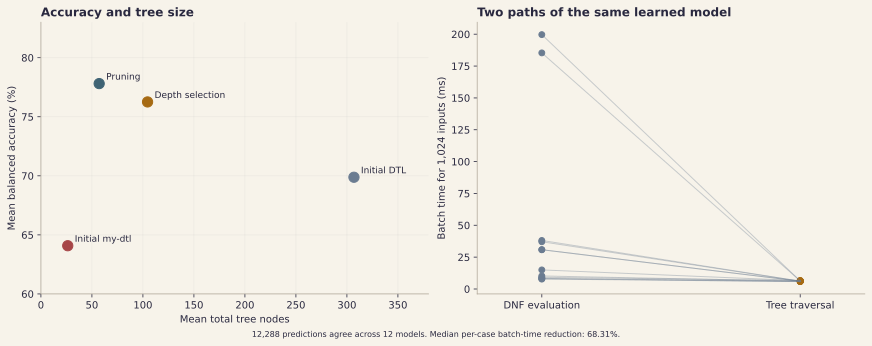
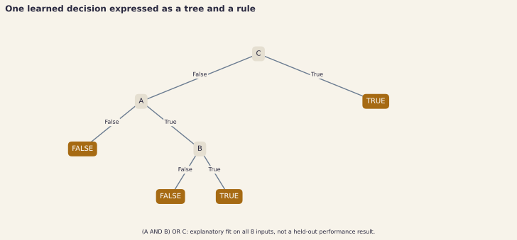
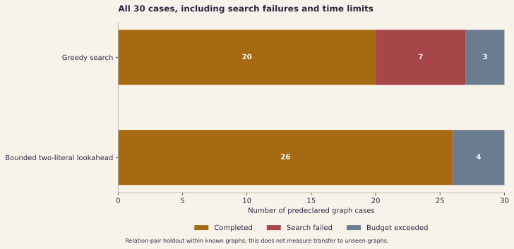

# Maintained experiment results

[English](results.md) | [한국어](results.ko.md) | [Project README](../README.md)

## Result and scope

The policy selected before final evaluation, **`gain-depth-tuned`**, achieved **76.25% mean test balanced accuracy**, compared with **64.08%** for the preserved initial `my-dtl` on the same 240 cases: **+12.17 percentage points**. The initial information-gain `dtl` achieved 69.88%.

`pruned-dtl` scored **77.81%**, the highest final balanced accuracy among the nine conditions. It remains an available implementation and its results are fully retained. The representative was not changed after looking at the final test results: choosing the highest final score would turn that test set into another model-selection set.

These are controlled synthetic Boolean-concept results, including an intentionally unstructured negative control. They do not establish accuracy on external tabular or production datasets. The unchanged [initial experiment report](experiment-report.md) uses a different protocol and remains separate.

## Experimental protocol

- Development: seeds 0–4, eight attributes, label-noise rates 0% and 30%, four concept families, **40 cases**.
- Final evaluation: previously untouched seeds 100–109, eight and ten attributes, label-noise rates 0%, 15% and 30%, the same four families, **240 cases**.
- Concept families: conjunction, sparse disjunction of conjunctions, three-variable XOR, and balanced random truth labels. Random truth is a negative control without a learnable shared concept.
- Class-stratified training and inner validation use nominal proportions of 60% and 20%; the remaining examples form the held-out split. Integer counts are recorded in each case.
- Every condition shares the underlying concept, exact split and training-only corrupted-label positions. Validation and held-out labels stay clean.
- The inner validation set chooses a depth from 2, 4, 6 and the number of attributes, with ties resolved by fewer nodes and then shallower depth. Reduced-error pruning also uses only inner validation.
- Outer development hold-outs choose the representative policy. [`configs/adoption.json`](../configs/adoption.json) froze the choice and source hashes before final evaluation.
- All **2,160 model evaluations** across nine conditions completed without a model failure.

Balanced accuracy is `(positive recall + negative recall) / 2`, so a majority-only classifier receives 50% despite class imbalance. Summary accuracy values are unweighted means over the 240 fixed cases. They are not pooled per-example accuracy over one dataset.

## All nine comparison conditions



| Condition | Test balanced accuracy | Test accuracy | Mean nodes | Median fit (ms) | Mean tuning (ms) |
| --- | ---: | ---: | ---: | ---: | ---: |
| Majority baseline | 50.00% | 63.39% | 1.00 | — | — |
| Initial `dtl` | 69.88% | 69.99% | 306.90 | 1.7880 | 0.0000 |
| Initial `my-dtl` | 64.08% | 68.19% | 26.31 | 1.0639 | 0.0000 |
| `corrected-dtl` | 69.89% | 70.00% | 306.86 | 2.5890 | 0.0000 |
| `gain-ratio` | 69.96% | 70.08% | 307.18 | 2.6833 | 0.0000 |
| `depth-limited` | 69.89% | 70.00% | 270.13 | 2.7792 | 0.0000 |
| `gain-depth` | 69.96% | 70.08% | 270.13 | 2.8472 | 0.0000 |
| **`gain-depth-tuned` (frozen representative)** | **76.25%** | **76.08%** | **104.56** | **2.6235** | **17.8389** |
| `pruned-dtl` | 77.81% | 78.22% | 57.12 | 4.0584 | 0.0000 |

Fit timings are medians of three fits within a case, then the median across cases. Depth-search cost is reported separately as mean tuning time. Pruning is part of `pruned-dtl`'s timed fit, rather than a separate zero-cost optimisation. The majority baseline's timing fields are not measured and are shown as dashes.

The representative uses **65.93% fewer mean nodes than initial `dtl`** (104.56 versus 306.90). It is larger than initial `my-dtl` (26.31 nodes), so this result trades some of the initial variant's extreme compactness and training speed for better held-out balanced accuracy. It does not support a claim that the new model is faster to train than both initial learners.



The paired representative-minus-initial-`my-dtl` difference is **+12.17 percentage points**, with a **95% Student-t interval of +10.27 to +14.08 points** over ten seed-level mean differences. Predictions within a seed are not treated as thousands of independent experiments. The interval describes this declared synthetic comparison and is not an external-dataset guarantee.

## Representative results by concept family

| Family | Initial `my-dtl` balanced accuracy | Representative balanced accuracy |
| --- | ---: | ---: |
| Conjunction | 76.61% | 95.08% |
| Sparse DNF | 79.42% | 91.01% |
| XOR | 50.70% | 68.74% |
| Random-truth negative control | 49.59% | 50.20% |

The near-chance negative-control result is expected: a tree cannot infer independent unseen random labels from their Boolean features. XOR remains materially harder than the sparse structured families. The aggregate improvement should not hide either limitation.

## Equivalent prediction execution

The learned DNF remains available as an explanation. Maintained prediction traverses the retained tree instead of testing every positive conjunction.



English and Korean rule figures use the same saved explanatory tree. To update only its Korean labels without fitting a model or touching benchmark records, run `python tools/generate_figures.py --language ko --only-rules` from this project directory. The command records the saved-model and generated-file hashes in `figures/rules-localization.json`.

The figure is an explanatory `(A AND B) OR C` example learned on all eight Boolean inputs, not an additional held-out performance result.

The separate final inference experiment used **12 fitted models**, each checked on its complete **1,024-input Boolean space**, for **12,288 identical tree and DNF predictions**. Each condition alternated execution order, used one warm-up pass, and recorded seven measured passes per path. The **median of condition-level batch-time reductions was 68.31%**.

This is CPU batch prediction for the same learned hypotheses and valid complete Boolean inputs. It is not a training-time improvement or a change in classification accuracy. Individual conditions and raw timings remain in [`reports/inference-evaluation.json`](../reports/inference-evaluation.json).

## Evidence and stopping decisions

- [Checked-in comparison plan](../configs/benchmark-plan.json)
- [Frozen adoption record](../configs/adoption.json)
- [Development cases and predictions](../reports/attribute-development.json)
- [Final cases, predictions, rules and timings](../reports/attribute-evaluation.json)
- [Development inference comparison](../reports/inference-development.json)
- [Final inference comparison](../reports/inference-evaluation.json)

Search stopped after the declared depth grid, one reduced-error-pruning candidate and the equivalent tree-execution experiment. Lower-scoring conditions remain visible as comparisons and supported implementations. The initial source snapshot and historical tables were not overwritten.

## FOIL finite-graph completion

The default greedy search is retained. An optional `lookahead=2` mode addresses a specific greedy dead end: when no one-literal extension has positive gain, it can consider a first literal that preserves positive bindings at zero gain and a second literal whose combined gain is positive. If a positive-gain one-literal extension exists, the original greedy choice is used. This is a bounded extension, not an unrestricted rule search.

Both comparison modes include the maintained lifecycle, error-handling and budget fixes. The 20-to-26 completion comparison isolates single-literal versus two-literal search policy; it is not a direct rerun of the untouched initial `aa947038` FOIL implementation.

The extension was developed using separate development cases. The final fixed matrix uses seeds 200–202, five graph topologies and node counts 8 and 16, for **30 cases per search mode**. The topologies are chain, disjoint cycles, disconnected chains, a dense DAG and self-loops. Every node has an explicit self-loop. A Python queue-based breadth-first search supplies labels independently of Prolog.

| Outcome over all 30 declared cases | Default greedy | Optional two-literal look-ahead |
| --- | ---: | ---: |
| Learning completed | 20/30 (66.67%) | 26/30 (86.67%) |
| Every held-out relation correct in the case | 19/30 | 25/30 |
| Search failed | 7 | 0 |
| Search budget exceeded | 3 | 4 |



Completion improved by **20.00 percentage points**, recovering all six cyclic cases that the greedy search could not learn. Twenty cases completed in both modes and have identical predictions. The extra search does not remove the resource limit: four final cases exceeded their declared budgets.

Across the **26 completed look-ahead cases**, **1,563 of 1,566** held-out relation pairs were correct (**99.81%**), with zero false positives and three false negatives. Precision is 100%, recall 99.44% and F1 99.72%. These are conditional metrics excluding the four unfinished cases, not accuracy or success over all planned cases. The unconditional completion and exact-case counts above remain the primary scope indicators.

Background edge facts remain visible during learning. The experiment measures held-out relation pairs within known graphs, not transfer to an unseen graph. Reported Prolog query counts count Python-to-Prolog calls, not internal proof steps.

```bash
python tools/benchmark_foil.py --seed-start 200 --output outputs/foil-final-greedy.json
python tools/benchmark_foil.py --lookahead 2 --seed-start 200 --output outputs/foil-final-lookahead.json
```

See the [greedy development report](../reports/foil-development-greedy.json), [look-ahead development report](../reports/foil-development-lookahead.json), [final greedy report](../reports/foil-final-greedy.json) and [final look-ahead report](../reports/foil-final-lookahead.json). Every predeclared case, including failures, remains in the reports.
